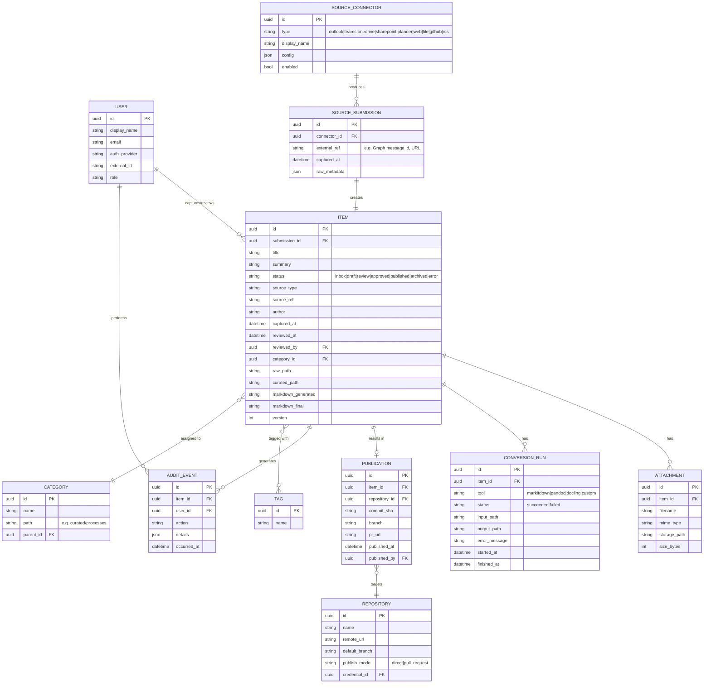
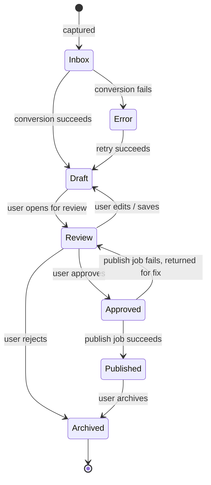

# Domain Model

## 1. Overview

Wiki Wrangler's domain centers on a single lifecycle entity, the **Item**, which
represents one piece of captured knowledge as it moves from raw capture to published
wiki content. Everything else (Source, Connector, Conversion, Attachment, Publication,
User, AuditEvent) supports that lifecycle.

## 2. Entity-Relationship Diagram

## 3. Entity Descriptions

### User
A person who can log in. Has a role (`Admin` or `Curator`) and an auth provider
(`local`, `entra`, `github`).

### SourceConnector
A configured integration instance (e.g. "My Outlook", "Team Docs SharePoint Site").
Connectors are configuration + credentials + polling/webhook state; they are the
things an admin enables/disables/configures.

### SourceSubmission
A single inbound unit of content from a connector or manual entry (one email, one
Teams message/thread, one uploaded file, one URL submission, one browser-extension
capture). A submission always results in exactly one Item.

### Item
The central entity. Represents one piece of knowledge moving through the pipeline.
Tracks:
- Lifecycle `status` (state machine, see below).
- Both the system-generated Markdown (`markdown_generated`, immutable per conversion
  run) and the user-edited final Markdown (`markdown_final`).
- Paths into the target Git repo for both the raw artifact and the curated article.
- A `version` counter incremented on every edit, to support optimistic concurrency and
  history within the review UI (independent of Git history, which starts at publish).

### Attachment
Binary assets associated with an Item (the original uploaded file, extracted images
from a DOCX/PDF, etc.). Stored in object/blob storage (filesystem volume in MVP).

### ConversionRun
An auditable record of one conversion attempt (tool used, input/output paths,
success/failure, error). An Item can have multiple ConversionRuns (e.g. retried with
a different tool, or re-run after a Docling upgrade).

### Category
A node in the curation taxonomy, mapped to a folder path under `curated/` in the
target repository. Hierarchical (supports nested categories).

### Tag
A free-form label, many-to-many with Item, used for cross-cutting discovery
independent of folder-based categorization.

### Publication
The record of an Item actually being committed/pushed (and optionally PR'd) to a
Repository. One Item has at most one active Publication per Repository; republishing
after an edit creates a new commit but updates the same Publication record (keeping
`commit_sha` as the latest).

### Repository
A configured Git target (remote URL, default branch, publish mode, which credential to
use). Wiki Wrangler can be configured with more than one Repository (e.g. a work KB and
a personal KB) though MVP ships with single-repository configuration as the default
path.

### AuditEvent
An immutable log row for any state-changing action (capture, edit, approve, reject,
publish, connector config change), capturing who did what and when.

## 4. Item Lifecycle (State Machine)

Notes:
- **Inbox**: raw submission received, conversion queued or in progress.
- **Error**: conversion failed; raw content is retained and visible; user can retry or
  manually transcribe.
- **Draft**: Markdown generated, not yet opened for review (or saved after an edit).
- **Review**: actively being reviewed; this is the state the review UI operates on.
- **Approved**: reviewer has approved; queued for publish job.
- **Published**: a Publication record exists with a commit the user can trace.
- **Archived**: terminal "will not publish" state (from rejection or post-publish
  retirement). Archived items remain queryable for audit/history.

## 5. Key Invariants

- Every `Item` has traceable provenance: `source_type` + `source_ref` always resolve
  back to the originating `SourceSubmission`, and `raw_path` always points to a file
  under `raw/` in the target repository (or object storage before first publish).
- `markdown_generated` is never edited in place; user edits live in `markdown_final`.
  This preserves the ability to diff "what the converter produced" vs. "what the human
  approved."
- An `Item` cannot transition to `Published` without an associated `Publication` row
  referencing a real commit SHA.
- Deleting a `Category` that still has `Item`s assigned is disallowed; items must be
  re-categorized first.
