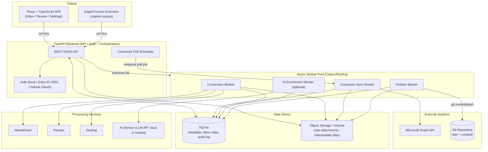

# System Architecture

## 1. Evaluation of the Proposed Architecture

The prompt proposed:

```
React / TypeScript
    ↓
FastAPI Backend
    ↓
Processing Services
├── MarkItDown
├── Pandoc
├── Docling
└── AI Services
    ↓
SQLite
    ↓
Git Repository
```

**Assessment: directionally good, but the "↓" layering implies a strict pipeline that
doesn't match the real data flow.** Specifically:

- SQLite is not "below" processing services in a pipeline sense — it's the system of
  record the API reads/writes throughout the whole lifecycle (inbox state, metadata,
  audit log), used **concurrently** with processing and publishing, not after them.
- Processing services (MarkItDown/Pandoc/Docling/AI) are **invoked by** the backend as
  asynchronous jobs, not a fixed linear chain every item passes through identically —
  which tool runs depends on source/file type.
- Git repository access is a **side effect of publishing**, triggered by the backend
  (or a dedicated publisher worker), not a downstream stage every item flows through
  automatically — human approval gates it.
- Source connectors (Graph, web capture, browser extension) and the **job queue /
  worker model** needed for long-running conversions and polling are missing from the
  diagram entirely.
- There's no mention of object storage for raw file blobs, nor of the browser
  extension as a distinct client.

The corrected architecture keeps the same technology choices (they are reasonable) but
models it as a **hub-and-spoke system around a backend API + job queue**, with SQLite
as shared state and Git as the publish target.

## 2. Revised Architecture



## 3. Components

### 3.1 Web UI (React + TypeScript)
Single-page app providing: Inbox list, Review screen (source / generated Markdown /
editable draft), Settings (connectors, repositories, users), Audit log viewer. Talks
only to the FastAPI backend over REST (+ optionally WebSocket/SSE for live job status).

### 3.2 Browser Extension
Manifest V3 extension (Edge/Chrome). Popup posts `{url, title, html, selection?}` to a
dedicated capture endpoint on the backend, authenticated via a long-lived device token
issued from the web UI (see [Edge Extension Architecture](./08-edge-extension-architecture.md)).

### 3.3 FastAPI Backend
Stateless HTTP API layer responsible for: authN/authZ, CRUD over Items/Sources/
Categories/Repositories/Users, enqueuing async jobs, serving job/status queries, and
exposing health/metrics endpoints. Does **not** itself perform long-running conversion
or Git operations synchronously — those are delegated to workers so the API stays
responsive.

### 3.4 Scheduler
A lightweight in-process (or APScheduler-based) component that enqueues periodic
"sync" jobs per enabled connector (e.g. poll Graph delta queries every N minutes) and
can also receive Graph webhook/change-notification callbacks where supported, reducing
polling latency.

### 3.5 Worker Pool
Executes four job types:
- **Conversion** — run the right tool(s) against a captured file/URL/submission and
  produce Markdown + metadata.
- **Connector Sync** — call Microsoft Graph (or RSS/GitHub) to pull new submissions and
  create `SourceSubmission` + `Item` rows.
- **AI Enrichment** — optional: title/summary/tag suggestion, categorization
  suggestion, duplicate detection — only runs when explicitly triggered or enabled.
- **Publish** — clone/pull the target repo (or use a persistent local working copy),
  write files, commit, push (and open a PR if configured).

Using a real job queue (not just FastAPI `BackgroundTasks`) is a deliberate
architecture decision so that conversions/publishes survive API restarts and can be
retried, rate-limited, and observed independently — important once Graph polling and
larger document conversions are involved.

### 3.6 Processing Tools (invoked by Conversion Worker)
- **MarkItDown** — primary converter for DOCX/XLSX/PPTX/simple PDF/HTML → Markdown.
- **Docling** — used when richer PDF extraction is needed (tables, OCR, layout-aware
  parsing); selected by a conversion-routing rule (file type + heuristics, e.g. PDF
  page count or presence of scanned images).
- **Pandoc** — secondary pass for Markdown dialect normalization/cleanup and for
  conversions MarkItDown/Docling don't cover well (e.g. further reformatting).
- **AI Service** — abstracted behind an internal interface so the backing LLM provider
  (local model via Ollama/vLLM, or a hosted API) is swappable via configuration.

### 3.7 Data Stores
- **SQLite** — all structured metadata: items, submissions, categories, tags,
  publications, repositories, users, audit events. Chosen per the original prompt for
  simplicity in a single-tenant self-hosted deployment; see
  [Database Schema](./05-database-schema.md) for the schema and a note on scaling
  beyond SQLite.
- **Blob/volume storage** — raw uploaded files, extracted images, intermediate
  conversion artifacts, and (optionally) a persistent local clone of the target Git
  repository used by the Publish Worker.

### 3.8 Git Repository
The actual wiki source repository. Wiki Wrangler treats it as an external system it
writes to via standard Git operations (clone/pull, write files, commit, push, optional
PR creation via the GitHub API) — never via any non-Git side channel — so the
repository remains fully usable by any other Git tooling.

## 4. Why FastAPI + a Separate Worker Pool (not just FastAPI background tasks)

- Conversions (especially Docling/OCR) and Graph polling can take seconds to minutes;
  running them in-process would block API responsiveness and risk loss on restart.
- A queue (Celery with Redis, or a lighter `arq`/RQ) gives retries, backoff, and
  visibility into stuck jobs, which matters once multiple connectors are polling
  concurrently.
- Decoupling also lets the worker pool scale independently (e.g. more conversion
  workers) without touching the API container.

## 5. Deployment Topology

See [Docker Architecture](./06-docker-architecture.md) for how these components map to
containers.

## 6. Cross-Cutting Concerns

- **Idempotency**: connector sync jobs use the external system's id (Graph message id,
  URL hash, etc.) to avoid creating duplicate `SourceSubmission`/`Item` rows on
  re-poll.
- **Observability**: structured JSON logs from API and workers; `/healthz` and
  `/metrics` (Prometheus format) on the API; job status queryable via API for UI
  progress indicators.
- **Extensibility**: new connectors implement a small `Connector` interface
  (`list_new_items`, `fetch_content`, `to_submission`); new converters implement a
  `Converter` interface (`can_handle(mime_type)`, `convert(path) -> Markdown`),
  registered in a routing table the Conversion Worker consults.
