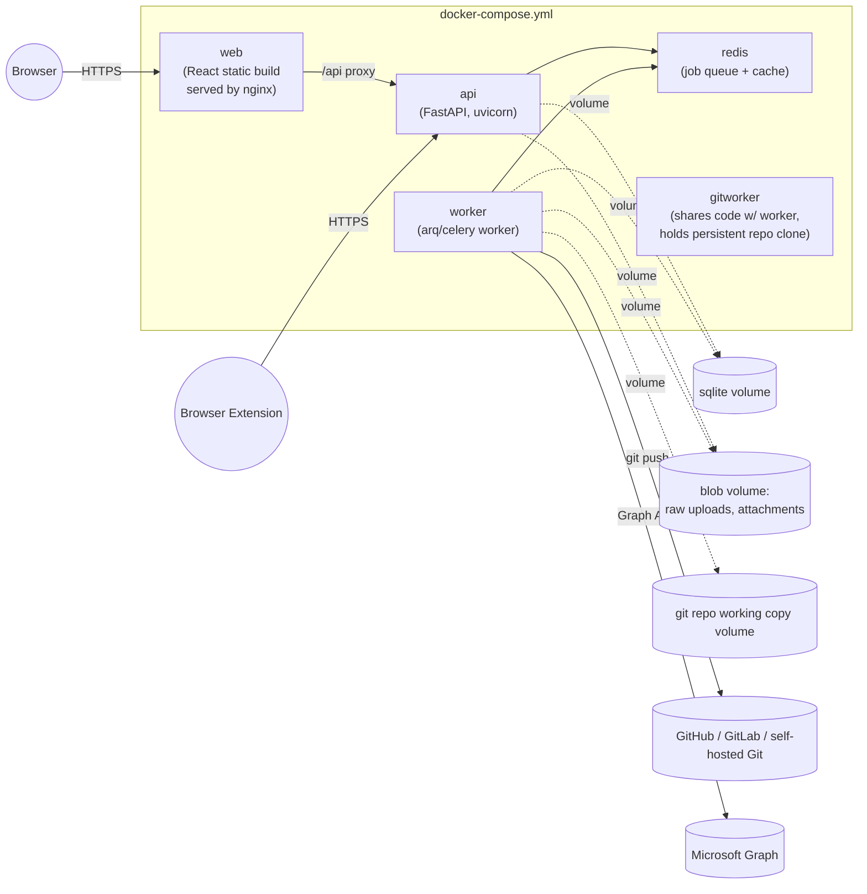

# Docker Architecture

## 1. Container Topology



Notes:
- `worker` is a single logical service in MVP (runs conversion, connector-sync, AI, and
  publish job types from one queue); it can be split into dedicated services
  (`worker-convert`, `worker-publish`, `worker-connectors`) later purely via Compose
  scaling/`replicas` and queue routing, with no code change beyond job-queue config.
- `redis` backs the job queue (arq/Celery broker) and can double as a short-TTL cache.
  For a smaller footprint, MVP may instead use SQLite-backed `arq`-style polling or
  `huey` with SQLite, deferring Redis to when multiple workers are needed — this is a
  configurable choice, documented as a trade-off in
  [Technology Stack](./13-tech-stack.md).

## 2. Example `docker-compose.yml`

```yaml
services:
  web:
    build: ./frontend
    image: wiki-wrangler-web
    ports:
      - "8080:80"
    depends_on:
      - api
    restart: unless-stopped

  api:
    build: ./backend
    image: wiki-wrangler-api
    command: uvicorn app.main:app --host 0.0.0.0 --port 8000
    env_file: .env
    volumes:
      - data:/data            # sqlite.db lives here
      - blobs:/blobs
    ports:
      - "8000:8000"
    depends_on:
      - redis
    restart: unless-stopped

  worker:
    build: ./backend
    image: wiki-wrangler-api   # same image, different command
    command: arq app.worker.WorkerSettings
    env_file: .env
    volumes:
      - data:/data
      - blobs:/blobs
      - repo-cache:/repo-cache
    depends_on:
      - redis
      - api
    restart: unless-stopped

  redis:
    image: redis:7-alpine
    volumes:
      - redis-data:/data
    restart: unless-stopped

volumes:
  data:
  blobs:
  repo-cache:
  redis-data:
```

## 3. Image Strategy

- **`backend` image** bundles FastAPI app + worker entrypoint + conversion tool
  dependencies (Python packages for MarkItDown/Docling, plus the `pandoc` binary
  installed via apt in the Dockerfile). Using one image for `api` and `worker`
  (different `command:`) keeps the dependency set in sync and simplifies CI builds.
- **`frontend` image** is a multi-stage build: Node build stage produces a static
  bundle, final stage serves it via nginx (or a tiny static file server), with an
  nginx reverse-proxy rule forwarding `/api/*` to the `api` service so the browser only
  ever talks to one origin (`web`), simplifying auth cookies and the extension's CORS
  story.
- Images are tagged and published via CI (GitHub Actions) to GHCR, enabling users to
  `docker compose pull && docker compose up -d` without local builds.

## 4. Volumes & Persistence

| Volume | Contents | Backup strategy |
|---|---|---|
| `data` | `wiki_wrangler.db` (SQLite) | File-level copy/snapshot; consider `sqlite3 .backup` on a schedule |
| `blobs` | Raw uploads, extracted images, intermediate conversion artifacts | Periodic archive; safe to prune items tied to `archived` status beyond retention window |
| `repo-cache` | Persistent local clone(s) of target Git repositories used by the publish worker | Not authoritative — can be deleted and re-cloned; the Git remote is the source of truth |
| `redis-data` | Job queue state | Ephemeral-ish; losing it only risks in-flight jobs, which are re-enqueued/retried |

## 5. Configuration & Secrets

- All runtime configuration flows through environment variables (`.env` file for local
  Compose, Docker/Swarm secrets or an external secrets manager for production), see
  [Security Model](./09-security-model.md).
- No secret values are baked into images.

## 6. Windows & Linux Support

- Docker Desktop (Windows) and native Docker Engine (Linux) both run the same Compose
  file; Linux-specific paths (e.g. bind mounts) are avoided in favor of named volumes
  to keep the Compose file portable.
- Line-ending and file-permission differences (common when bind-mounting a Git repo
  clone from a Windows host) are sidestepped by having the publish worker **always
  perform the clone inside the container volume**, not on a host bind mount, so Git's
  view of file modes/line endings is consistent regardless of host OS.

## 7. Scaling Path

- Single-host Compose is the MVP target. The same images can later be deployed to
  Kubernetes (api + worker Deployments, Redis as a managed dependency, and SQLite
  replaced by PostgreSQL — see [Database Schema](./05-database-schema.md) §1 scaling
  note) without changing application code, only deployment manifests.
