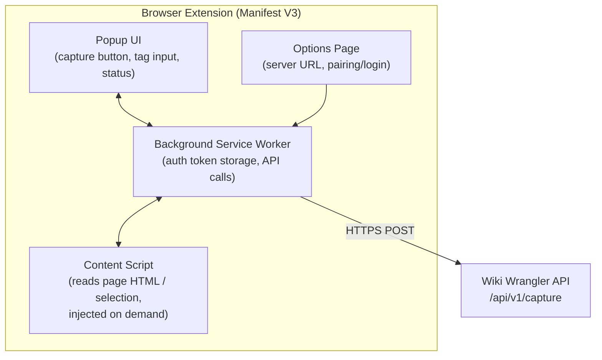
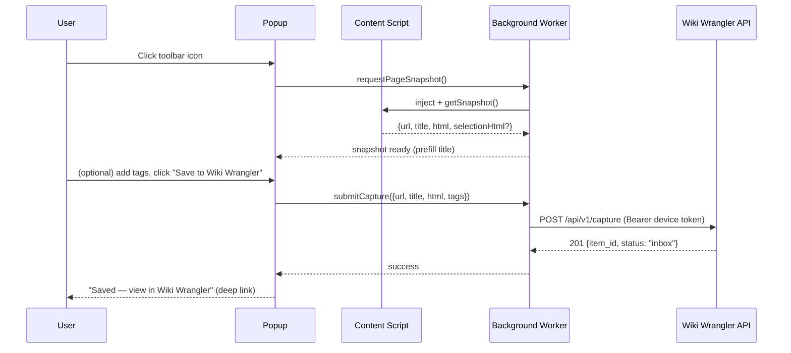

# Edge Extension Architecture

## 1. Goal

Allow a user to capture the page they're currently viewing — URL, title, and rendered
HTML (optionally just a selection) — into their Wiki Wrangler inbox in one click,
without downloading or manually copy/pasting anything.

## 2. Platform & Packaging

- Built as a **Manifest V3** browser extension, which runs unmodified on Microsoft Edge
  and Chrome (both Chromium-based, same extension APIs) and can be published to both
  the Edge Add-ons store and Chrome Web Store from one codebase.
- Stack: TypeScript, bundled with Vite (`vite-plugin-web-extension` or similar), no
  framework needed for the small popup UI (or a tiny React popup if consistency with
  the main web app's component library is preferred).

## 3. Components



- **Popup UI**: shown when the user clicks the toolbar icon. Displays page title
  (pre-filled), an optional tag input, a "Capture full page" vs "Capture selection"
  toggle (Phase 2), and a Capture button with inline success/error feedback.
- **Background service worker**: holds the extension's auth token (see §5), performs
  the actual `fetch()` to the backend, and relays messages between popup and content
  script.
- **Content script**: injected into the active tab on demand (not persistently, to
  minimize permissions/performance impact) to read `document.documentElement.outerHTML`
  and, for Phase 2, `window.getSelection()`.
- **Options page**: lets the user set the Wiki Wrangler server URL (important for
  self-hosted deployments with non-default hostnames) and initiate pairing/login.

## 4. Capture Flow (Sequence)



## 5. Authentication: Device Token Pairing

Browser extensions should not hold the user's primary session cookie or OAuth
refresh token. Instead:

1. In the Wiki Wrangler web UI (already logged in), the user goes to
   **Settings → Browser Extension** and clicks **Generate Pairing Code**.
2. The backend creates a `device_tokens` row (see
   [Database Schema](./05-database-schema.md)) and returns a short-lived, one-time
   pairing code (6-8 chars) plus the long-lived token value (shown once).
3. The user enters the server URL + pairing code into the extension's Options page (or
   scans a QR code shown by the web UI, for faster pairing on the same machine);
   the extension exchanges the pairing code for the long-lived device token via a
   dedicated `/api/v1/devices/pair` endpoint, then stores it in
   `chrome.storage.local` (not `localStorage`, which content scripts/pages could read).
4. All subsequent capture requests use `Authorization: Bearer <device_token>`.
5. Device tokens are revocable individually from the web UI's Settings page (handles
   lost/stolen devices) without affecting the user's normal login session.

This mirrors common patterns (e.g. GitHub CLI device flow, Todoist/Notion web
clippers) and keeps the extension's blast radius limited to the capture endpoint only
— a stolen device token cannot read other users' content, approve items, or change
settings, enforced by scoping the token to a `capture:write` permission only.

## 6. Backend Capture Endpoint

```
POST /api/v1/capture
Authorization: Bearer <device_token>
Content-Type: application/json

{
  "url": "https://example.com/article",
  "title": "Example Article",
  "html": "<html>...</html>",
  "selection_html": null,
  "tags": ["reference"]
}
```

- Creates a `source_submissions` row with `connector_id = <the built-in "web" connector>`
  and `external_ref = sha256(url)` for idempotency (recapturing the same URL updates the
  existing submission/Item rather than duplicating it, mirroring the Graph connector
  behavior).
- Stores the raw HTML as an `Attachment`, enqueues a **Conversion** job using the same
  HTML→Markdown path used for Graph-sourced HTML content and for manual URL
  submissions — the extension is just another producer of `SourceSubmission`s, not a
  special case in the processing pipeline.
- Returns `item_id` so the popup can show a deep link
  (`https://wiki-wrangler.local/items/{item_id}`) straight into the Review screen.

## 7. Required Extension Permissions

Kept minimal and justified for store review:

- `activeTab` — read the current tab's content only on explicit user action (no
  background page scraping).
- `scripting` — to inject the content script on demand.
- `storage` — to persist the device token and server URL locally.
- Host permission limited to the configured Wiki Wrangler server origin (requested
  dynamically via `optional_host_permissions`, not a broad `<all_urls>` grant), so the
  extension can call the API without requesting access to all websites.

## 8. Future Capabilities (Post-MVP)

- Capture only selected text (`selectionHtml` already modeled above for forward
  compatibility).
- Capture a screenshot (`chrome.tabs.captureVisibleTab`) attached alongside the HTML.
- "Capture PDF URL" — detect when the active tab is a PDF viewer and submit the PDF
  blob instead of HTML.
- Pre-capture tagging/category picker populated from the user's existing Wiki Wrangler
  categories (requires an additional read-scoped API call from the popup).
- Readability-mode preview in the popup before submitting, to catch obviously broken
  captures (ads/nav clutter) before they hit the inbox.
