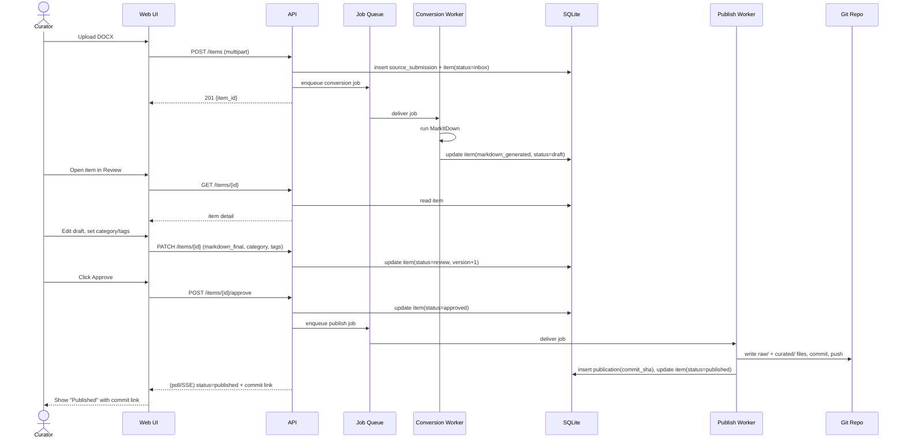
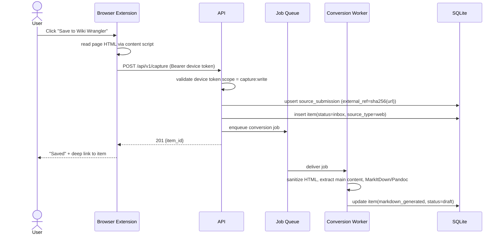
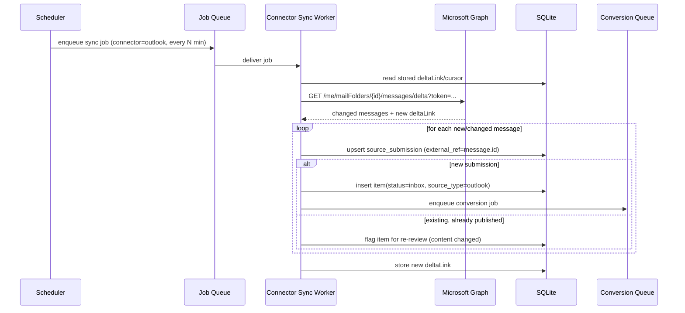
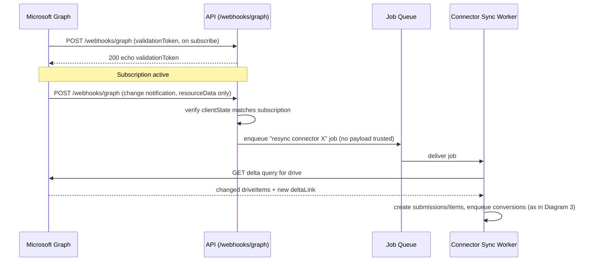
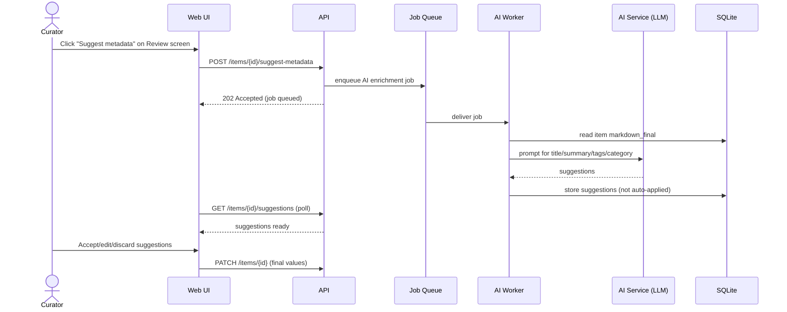
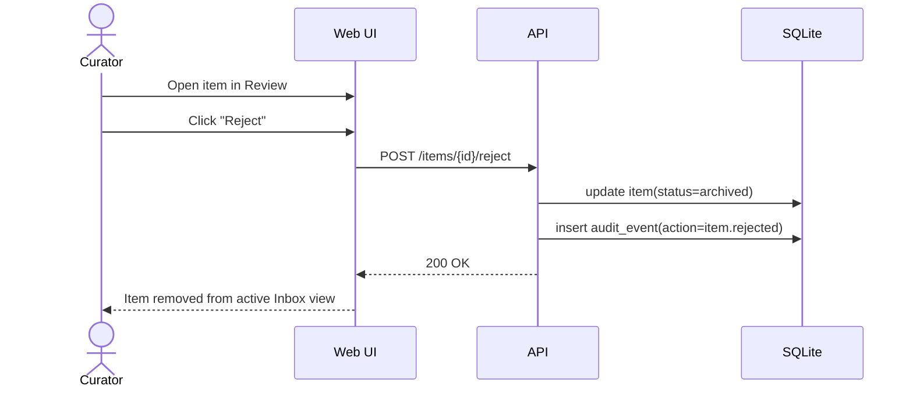

# Sequence Diagrams for Major Workflows

## 1. Manual File Upload → Publish (Core Loop)

## 2. URL / Browser Extension Capture

(Review/Approve/Publish continue exactly as in Diagram 1.)

## 3. Microsoft Graph Connector Sync (e.g. Outlook)

## 4. Graph Webhook-Triggered Sync (OneDrive/SharePoint)

## 5. AI-Assisted Metadata Suggestion (Post-MVP)

## 6. Rejected / Archived Item

